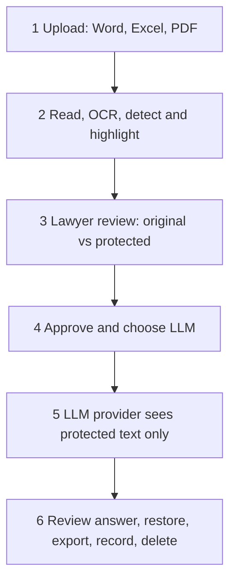

# AI-safe legal tool: project brief (Governance MVP)

Status: working draft, 19 October 2026
Scope of this document: everything agreed or discussed so far. Items are marked **Decided**, **Leaning**, **Proposed** (suggested, not yet confirmed) or **Open**.

---

## 1. Business statement

A commercial software product that lets lawyers, solicitors and law firms use AI on client material without the worry of breaching client confidentiality or data protection law. The product controls what data flows to AI tools, shows the lawyer exactly what is protected, and leaves an auditable record.

- First market: UK, then expand gradually.
- Sold as AI-safe/secure with a strong focus on privacy and GDPR. Wording must stay precise (see section 9).
- Not a research exercise and not a file management system: the aim is something real, marketable and commercially viable.

## 2. Product vision: GRC, three pillars in one integrated product

| Pillar | Purpose | Status |
|---|---|---|
| **G**overnance | Privacy and safe-AI-use gateway: control what data reaches AI | **MVP focus (this document)** |
| **V**erification and Reliance | Check AI-generated legal work (sources, citations, sign-off) | Later |
| **C**ompliance | Client and matter file reviews inside a common workspace | Later |

How the pillars connect later (Proposed): a shared matter record and audit log. Protect (G) → AI → Verify (V) → lawyer sign-off → file to matter, with (C) reviewing the matter file itself.

## 3. Target users and positioning

- Users: lawyers, solicitors and law firms, including people with limited AI experience.
- Likely best first segment (Proposed): small and mid-size UK firms. Large firms already tend to have platforms and governance committees.
- Constraints on the product (Decided):
  - Standalone website or software. **No plugins** (no browser extensions or Office add-ins).
  - Must not disrupt firms' existing infrastructure.
  - Minimal technical fluff.
- Ambition: easier to use than ChatGPT, with the safety and paper trail a regulated firm needs. Stickiness should come from value (matter history, audit record, configured policies, habit), not from trapping data.
- Design principle (Decided): the lawyer works **with** the tool and does not trust it blindly. Mistrust is built into legal practice and errors are costly.

## 4. Market landscape (first-pass search, October 2026; not a full competitor teardown)

- **Redaction tools** (detect and permanently remove sensitive data from legal documents): Dr. Redact, RedactifyAI, Redactable, RedactSense (on-device), Pandektes Redact, and redaction features inside broader platforms such as Luminance. They produce a redacted file; they do not protect, send to an LLM and restore.
- **AI governance layers:** CounselGuard (audit and policy layer above existing AI tools, using a desktop agent and browser extensions), DeepInspect (matter-level approval), FireTail, LAW.co (services), and enterprise tools such as OneTrust.
- **Legal AI platforms** (the indirect competition): Harvey, Lexis, Westlaw, Clio, Microsoft Copilot. For many firms the alternative to this product is buying one of these.
- **Demand signals:**
  - A 2026 Clio report found 89% of UK and Ireland legal professionals use AI and 17% of firms have no formal AI policy.
  - A LexisNexis survey reported the SRA is concerned firms are not adequately mitigating confidentiality risks when using AI.
  - A survey of 200 UK legal professionals (Access Legal, commissioned) found 59% admit using unapproved AI tools for client work. Small sample, vendor-commissioned.
  - Firms adopt tools more readily when they fit existing workflows.
- **Possible gap:** a lightweight protect → send → review → restore workflow with bring-your-own LLM, a light matter workspace and (later) verification, aimed at small and mid-size UK firms. Needs confirming with a deeper competitor check and customer interviews.

## 5. MVP scope

### In scope
- Light workspace: upload Word, Excel, PDF (with OCR) and classify by client and matter. Not a file manager.
- Detection and flagging of sensitive items (rules first, models for fuzzy cases).
- Side-by-side review: original on one side, protected version on the other, plus a summary panel.
- User chooses the protection mode (see section 7).
- Block and explain when a file is unreadable, OCR confidence is low or detection is unsure.
- Bring-your-own LLM connection (API key). GPT, Claude and Gemini first.
- First task: **summarise**.
- Answer review, restore (where the mode allows), export, and a minimal audit record.

### Out of scope for now
On-prem deployment (maybe later), integrations with case management or document systems, Verification and Compliance pillars, firm-level policy floor, true anonymisation mode, hosting your own models, case-level multi-document tasks, billing or time recording.

## 6. Data flow

Six steps from the team's handwritten workflow (**Decided**; flow diagram deliberately left unchanged for now, to be enhanced later):

1. **Upload** the document (PDF, Excel, Word).
2. **Detect** sensitive information; the tool highlights it.
3. **Human review:** side-by-side page, original on one side and edited (protected) on the other.
4. **Approval** and designation of the LLM to use.
5. **Response** from the LLM: the summary, or whatever the user wants.
6. **Restore, record and delete:** restore real details (if the mode allows), keep the audit record, delete what should not be kept.

Cross-cutting controls (Proposed, to attach to the steps rather than add steps):
- Block and explain on unreadable or unsure input.
- The lawyer's typed prompt goes through the same detection as uploaded files.
- Nothing is sent without an explicit click; uncertain items must be resolved first.
- Outbound check: re-scan the outgoing text for any known real value before sending.
- Inbound check: scan the answer for leaked real values or new identifiers.
- Provider check: show what is known about the provider's data handling before first use, with a recorded verification date.

## 7. Key design decisions

| Area | Choice | Status |
|---|---|---|
| Pillar order | Governance first | Decided |
| Form factor | Standalone web tool, no plugins, no infrastructure disruption | Decided |
| First task | Summarise (rebuttals, arguments and second opinions later) | Decided |
| File types | Word, Excel, PDF, with OCR | Decided |
| Review UX | Side-by-side original vs protected; summary plus full document; not approving every item | Decided |
| Failure behaviour | Block and explain | Decided |
| Protection mode | User chooses; user is leaning towards redaction but is unsure | Leaning |
| Mode naming | "Restorable" (placeholders, key kept) and "Permanent" (no restore). Avoid calling either "anonymised" | Proposed |
| Placeholders | Typed, consistent labels (for example PERSON 1) so summaries stay coherent | Proposed |
| LLM connection | Bring-your-own API key; GPT, Claude, Gemini first; no use of personal account logins or stored passwords | Decided (providers); Proposed (custom endpoint marked unverified) |
| Audit log | Minimal, metadata only; opt-in retention of the exact sent text, encrypted under the firm's key | Decided |
| Hosting | Team's own servers for now; on-prem maybe later | Decided |
| Key | Generated in the firm's browser so the team never sees it; one key per firm with a derived key per matter; held by the client | Decided |
| Restore | Done in the user's browser using the firm's key | Proposed |
| Detection principle | Use AI only where truly non-deterministic; rules and validators for structured identifiers | Leaning |
| Detection location | Browser vs server | Open (team discussing) |

## 8. Safety approach: layers

1. Deterministic rules and validators first, models only for fuzzy cases.
2. Human review gate with an explicit send click.
3. Fail-safe blocking for unreadable files, low OCR confidence or unresolved items.
4. Outbound check before sending and inbound check on the answer.
5. Provider readiness check, with the verification date shown in the product.
6. Content-free, tamper-evident audit log.
7. Prompt screening, not only file screening.
8. A test set of synthetic documents with seeded identifiers, tracking the miss rate on every change.
9. Hidden-content handling: comments, tracked changes and metadata in Word; hidden sheets, formulas and comments in Excel; hidden text layers in PDF.
10. Contextual-risk flags for identifying facts that no rule will catch.

## 9. Legal and regulatory notes (to be verified by a qualified UK data-protection solicitor)

- No processing step makes a document "legally safe" or "GDPR compliant" on its own. Compliance depends on the whole arrangement: lawful basis, contracts with providers, where data goes, how much is shared. The product reduces risk and produces evidence.
- Under UK GDPR and ICO guidance, pseudonymised data remains personal data, particularly for whoever holds both the data and the key. Anonymisation is hard to achieve and prove for rich legal text.
- **EDPS v SRB (CJEU, C-413/23 P, 4 September 2025):** pseudonymised data is not necessarily personal data for every recipient; it is personal data for those who can reasonably re-identify people. The controller's duty to inform people about recipients stays regardless. If a recipient holds the key, its position changes. This is an EU judgment, so its weight under UK law needs checking. It also leaves open whether processor contracts apply to pseudonymised data.
- Implications for the product:
  - The LLM provider receives placeholders and not the key, which may help its position, but context can still re-identify people.
  - The firm keeps its duties (lawful basis, transparency). A possible feature: help firms record AI providers as recipients.
  - The team hosts data and its server sees raw documents while processing, so it is a processor either way. A firm-held key helps with stored data and breach exposure but does not remove obligations.
- Wording: describe modes by what they do. Say the product reduces identifiability and risk. Avoid absolute claims such as "anonymised", "fully GDPR compliant" or "fool-proof".
- Questions for the law teammate and a solicitor: legal status of the two modes, the processor role and DPA terms, SRA obligations on AI and confidentiality, privilege implications of third-party handling.

## 10. Technical stack options (nothing final)

- **Interface:** web app (workspace, side-by-side review, answer view).
- **File reading:** libraries for Word, Excel and PDF that expose hidden content; **local** OCR (cloud OCR would defeat the purpose).
- **Detection:** validators and pattern rules for structured identifiers; open-source named-entity model for names and context.
- **Placeholder engine:** consistent entity resolution including aliases; rebuild files without breaking formatting.
- **Key and storage:** encryption in the browser or device with firm-held key; encrypted storage for the mapping.
- **LLM layer:** one adapter interface for GPT, Claude and Gemini, plus a generic OpenAI-compatible endpoint for custom or self-hosted models, marked unverified.
- **Relay consideration:** calling providers directly from a browser can hit cross-origin restrictions and exposes the key; a thin relay that stores and logs nothing may be needed.
- **Backend (minimal):** sign-in (possibly Microsoft/Google), provider settings, append-only metadata log; UK hosting.
- **Cost advantage:** a bring-your-own API key means no inference bill for the team.

## 11. Risks and pain points

1. Detection misses are breaches; one missed identifier can expose a client.
2. Placeholders can reduce AI output quality; restore must be correct.
3. A new vendor handling sensitive data faces security questionnaires, insurer questions, certifications and slow sales cycles.
4. Shadow AI: free ChatGPT is frictionless, so the tool must be as easy.
5. Bring-your-own API keys are unfamiliar to non-technical users.
6. Bundled competition from Copilot, Clio, Lexis and others.
7. Scope: three pillars plus a workspace is a lot for a three-person team.
8. Liability: claims, indemnity and professional indemnity cover.
9. Regulation and guidance are still moving.
10. Hosting raw client data on the team's servers raises the "data is leaving the environment" objection.

## 12. Testing and validation plan

- Use **synthetic documents only** (Word, Excel, PDF, scanned) with seeded identifiers. Never real client data.
- Measure miss rate and time from sign-in to first useful summary. Targets worth aiming for: under two minutes to first result and no more than two clicks of protection per document.
- Early feedback from LLM (law master's) students; treat as early signal, not validation, since they are not practising solicitors.
- Later: interview around ten solicitors or practice managers about current AI use, willingness to pay and adoption blockers; run a small pilot with a design-partner firm.

## 13. Open questions (parked; to answer as the product is enhanced)

- Detection location: browser or server (team discussing; a short spike on synthetic documents would settle accuracy and speed).
- Accounts and sign-in, and multi-user firms (including how a second lawyer gets key access without the team handling the key).
- What exactly gets deleted, and when (raw upload, protected copy, mapping, sent text).
- Who keeps the audit record (the firm's evidence copy versus any record held by the team).
- Case-level tasks across many documents (needs a per-matter mapping, cross-document consistency, retrieval and storage decisions).
- Legal wording and status of the two modes.
- Key recovery process for firms that lose their key.
- How the pilot will be run and how it will be priced.
- On-prem deployment (later).

## 14. Team and constraints

- Three people: two AI engineers and one law student (LLM at LSE). Three laptops, no funding.
- No existing contacts among practising solicitors yet.
- Implication: keep infrastructure cheap, rely on bring-your-own API keys, and win credibility through transparency and a small pilot before certifications.

## 15. Suggested next steps

1. Start the technical exploration: file parsing (including hidden content and OCR) and a detection evaluation on synthetic documents.
2. Ask the law teammate for a one-page note on the legal status of the two modes under UK GDPR, and on the EDPS v SRB point.
3. Draft the click-by-click user journey for the MVP.
4. Build a synthetic test set with seeded identifiers.
5. Arrange interviews with practising solicitors.

## Sources (first-pass research)

- Dr. Redact: https://www.legaltechnologyhub.com/vendors/dr-redact/
- Redactable: https://www.redactable.com/redactable-use-cases/law-firm-redaction
- Luminance redaction: https://www.cambridgenetwork.co.uk/index.php/news/luminance-launches-ai-powered-redaction-tool
- RedactSense: https://www.legaltechnologyhub.com/vendors/redactsense/
- CounselGuard: https://www.legaltechnologyhub.com/vendors/counselguard/
- DeepInspect: https://www.deepinspect.ai/blog/ai-governance-law-firms
- Clio UK and Ireland report coverage (Law Gazette): https://www.lawgazette.co.uk/news/ai-is-mainstream-in-law-but-clients-are-not-told/5126414.article
- LexisNexis survey coverage: https://www.localgovernmentlawyer.co.uk/marketplace/603-technology-news/101594-survey-finds-widespread-adoption-of-ai-by-legal-professionals-but-concerns-remain-over-inaccurate-information
- Access Legal survey coverage: https://www.resultsense.com/news/2026-05-19-uk-lawyers-unauthorised-ai-use/
- EDPS v SRB commentary: https://www.garrigues.com/en_GB/new/pseudonymized-data-personal-data-key-points-following-european-court-justices-judgment-edps-v ; https://www.jonesday.com/de/insights/2025/09/cjeu-clarifies-scope-of-personal-data-in-edps-v-srb-decision ; https://ourtake.bakerbotts.com/post/102l35z/cjeu-clarifies-requirements-and-definition-of-pseudonymisation ; https://cm.twobirds.com/en/insights/2025/eu-the-srb-decision-a-new-era-for-personal-data-and-data-processing-agreements
- ICO anonymisation guidance extract: https://ICO.ORG.UK/media/about-the-ico/consultations/4019579/chapter-3-anonymisation-guidance.pdf
